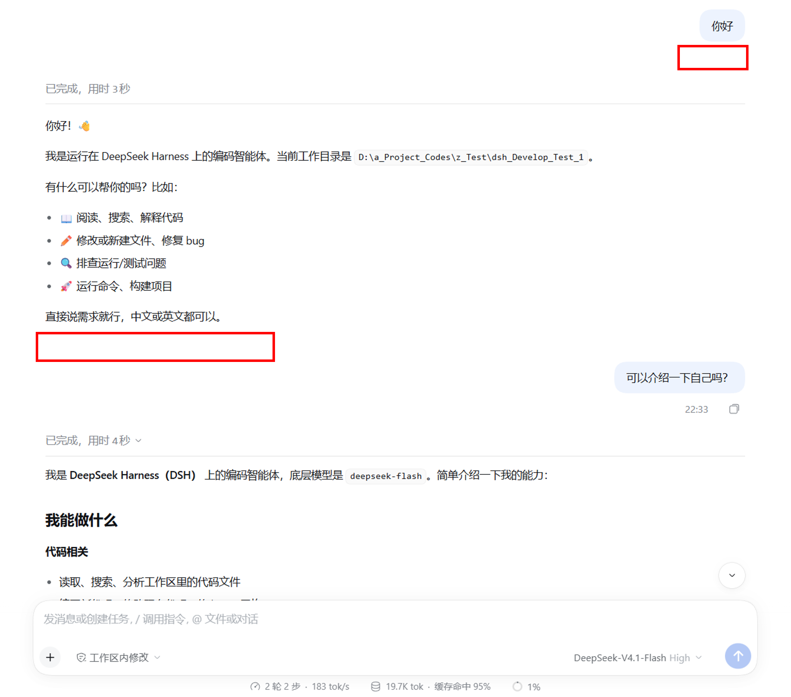
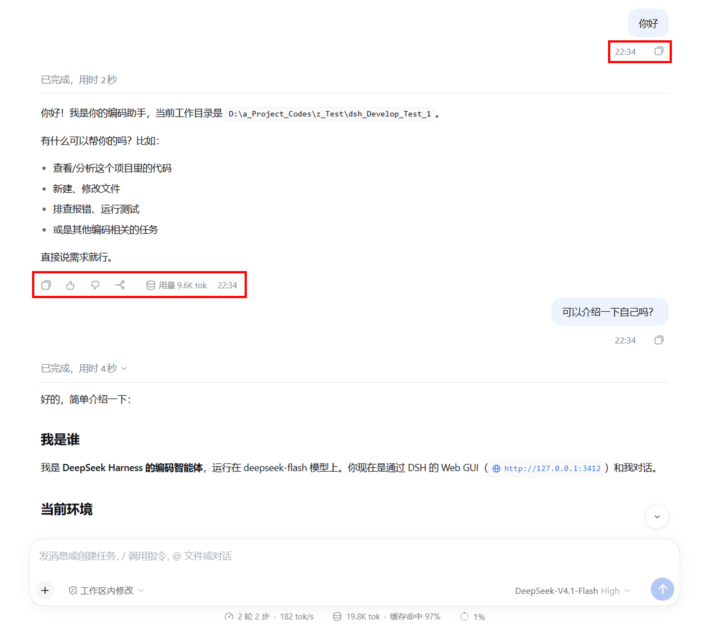

# dsh-visible-action-row

> DeepSeek Harness（桌面版 / Web 版）插件：让每条消息——用户消息与 DSH 消息——气泡下方的**整条操作栏**无需悬停即可始终显示。

DSH 原生只在**最新一轮**消息上常显这条操作栏（复制 / 点赞 / 点踩 / 分支等按钮、时间，以及其他插件向该区域添加的按钮与信息），历史消息需要悬停才出现。本插件以一条 scoped CSS 可见性覆盖，让**每条**消息的操作栏都保持最新一轮那样的常显状态：复用原生渲染、原生位置与原生内容，不新增任何可见 UI。

- **Always visible**：用户与 DSH 消息的操作栏全部常显，含历史消息；悬停前后一致
- **Native content**：按钮、时间与第三方插件塞进该行的内容原样显示——不重新生成、不改格式
- **Zero config**：无设置项、无开关、无存储、无后端、无网络请求，安装即生效
- **Clean uninstall**：卸载后恢复原生「仅最新一轮常显」行为，不残留 DOM / CSS / 配置
- **Minimal & safe**：不扫描 DOM、无 MutationObserver、无轮询；仅调整 `opacity`，按钮行为与悬停效果不变

维护：[Bobnemimimmi](https://github.com/Bobnemimimmi) · 问题与反馈：[GitHub Issues](https://github.com/Bobnemimimmi/dsh-visible-action-row/issues)

## Preview

**安装前（Before Installation）**



**安装后（After Installation）**



## Usage

### 安装（Installation）

- **通过 DSH Desktop 安装（Install through DSH Desktop）**

  1. 打开侧栏 **插件**（Plugins）页；
  2. 点击 **添加插件**（Add plugin）旁的箭头，选择 **安装第三方插件**（Install a third-party plugin）；
  3. 输入 `dsh-visible-action-row` 安装，安装完毕后点击 **立即启用**。

- **通过 npm 安装（Install through npm）**

  ```sh
  dsh plugin --profile web add dsh-visible-action-row
  ```

  npm 安装拿到的是发布时构建好的成品，无需任何构建授权。

- **从 GitHub 安装（Install through GitHub）**

  会运行本包的 `prepare` 自构建；pnpm ≥10 首次 `add` 会拒绝并要求授权，按提示把打印的 `allowBuilds` 键加入 profile 的 `pnpm-workspace.yaml` 后重跑：

  ```sh
  dsh plugin --profile web add github:Bobnemimimmi/dsh-visible-action-row
  ```

- **本地目录 / tarball 安装（Local directory / tarball installation）**

  ```sh
  dsh plugin --profile web add ./dsh-visible-action-row
  ```

- 或通过 [Awesome DeepSeek Harness (DSH) Plugin](https://github.com/awesome-dsh-plugin/awesome-dsh-plugin) 搜索安装（Search and install from the awesome list）

用命令行安装后，重启 DSH 即生效（桌面版重启应用；Web 版重启 `dsh web`）。

> 桌面版使用的 profile 名为 `desktop`：把上面命令里的 `--profile web` 换成 `--profile desktop`。

### 卸载（Uninstallation）

```sh
dsh plugin --profile web remove dsh-visible-action-row
```

重启后恢复原生「仅最新一轮常显」行为（restart DSH to restore the native behaviour）。

### 从 0.1.x 迁移（Migrating from 0.1.x）

旧包 `dsh-always-status-bar` 只覆盖时间戳，且其锚点在 DSH 0.2.x 中已变更（因此在新版里实际为空转）。建议先移除再安装新包：

```sh
dsh plugin --profile web remove dsh-always-status-bar
dsh plugin --profile web add dsh-visible-action-row
```

## Requirements

- DeepSeek Harness：桌面版，或 `dsh web`（二进制安装 / 源码启动均可）
- 已验证：
  - 桌面版 `0.2.1-rc.5`（Windows 11）
  - 源码启动的 Web `0.2.2-alpha.2`（Windows 11）
  - 两者加载同一套前端产物；macOS / Linux 未单独实测，但同一份 client bundle 不含平台分支
- `dsh` CLI（或按 DSH 文档以源码方式运行 `pnpm dsh`）

若升级 DSH 后操作栏不再常显，请核对以下稳定锚点是否仍存在于 `packages/client/ui-chat/src/client/chat/`：

- `MessageIconActions.tsx` → 操作栏根节点的 `data-clock`
- `TurnTailNodeView.tsx` → `data-actions-reveal`
- `ChatNodeSeat.tsx` → `data-chat-flow-kind`

## License

MIT
